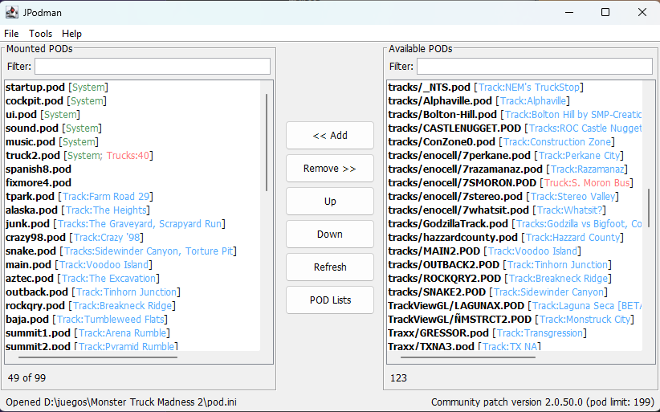

# JPodman

[](https://adoptium.net/)
[](#requirements)
[](LICENSE)

**POD mounting utility for TRI games.**

JPodman manages the `pod.ini` mount list that Terminal Reality's games read at
startup. It finds the POD archives on your disk, tells you which tracks and
trucks each one contains, warns you when two PODs fight over the same file, lets
you set the mount order, then saves and launches the game.



> [!TIP]
> On Windows, [KPodman](https://github.com/juanputrerasm/KPodman) is the same
> program built as a native application, with no Java needed. The two share the
> same `pod.ini` and preferences formats, so you can switch between them freely.

---

## Supported games

Detected automatically from the executable in the game folder:

| Game | Executable | Known POD limit |
|---|---|---:|
| Monster Truck Madness 1 & 2 | `monster.exe`, `monsterx.exe` | from the build |
| Terminal Velocity | `TV.EXE` | 15 |
| Fury3 | `FURY3.EXE` | 15 |
| Hellbender | `HELLBEND.EXE` | 15 |
| CPR | `cart.exe` | 30 |
| Nocturne | `nocturne.exe` | none |
| 4x4 Evo / 4x4 Evo 2 | `4x4.exe`, `4x42.exe` | none |

Monster Truck Madness has three extras the others do not: executable version
detection, the `system/monster.ini` editor, and registry repair. Those menu
items are disabled in a non-MTM folder.

---

## Features

- **Two-list editor.** Mounted PODs on the left, everything available on the
  right. Add, remove, and reorder; the mount order is what gets written.
- **Reads inside your PODs.** Parses POD1, POD2 and EPD archives and shows the
  track and truck names each one contains, colour-coded in the list.
- **Conflict detection.** Flags PODs that define the same `.SIT`/`.TRK` file,
  since only the last one mounted actually wins.
- **System POD tagging.** The PODs the game needs are marked, and the list is
  editable in Preferences.
- **Live filtering** on every list, plus an **Add...** button for POD files
  anywhere on disk.
- **Stock presets.** Restore the full or minimal system POD set, resolving each
  entry through `Fixes/`, `Stock/`, or the bare file name.
- **Saved POD lists.** Keep named setups, import someone else's `pod.ini`, and
  apply a list to the game in one click.
- **POD limit awareness.** Warns before launching with more PODs than the
  detected game is known to handle.
- **`monster.ini` editor** (MTM). In-game fonts, localization file, extra horn,
  numeric latency and the secret track. Comments and unknown keys are preserved.
- **Registry repair** (MTM, Windows only). Recreates MTM's `HKLM` entries
  (32-bit view) for MTM1, MTM2 or the MTM2 Demo, pointed at your install folder.

---

## Requirements

[Java 17 or newer](https://adoptium.net/). Windows, macOS or Linux.

The registry tools are Windows only, and need JPodman to be run as
administrator.

---

## Getting started

```sh
java -jar jpodman.jar
```

1. Run it from your game folder. The startup folder defaults to the working
   directory; otherwise use **File > Open Game Folder...**.
2. Select PODs on the right and press **<< Add** (or double-click them).
3. Reorder with **Up** / **Down**. Later PODs override earlier ones.
4. **File > Save and Launch**.

---

## Usage

### Main window

| Control | Action |
|---|---|
| **<< Add** / double-click | Mount the selected available PODs |
| **Remove >>** / double-click | Unmount the selected mounted PODs |
| **Up** / **Down** | Move the selected mounted POD in the load order |
| **Refresh** | Re-scan for POD files |
| **POD Lists** | Open the saved POD list manager |
| **Add...** | Mount POD files from anywhere on disk |
| **Filter** | Narrow either list as you type |

Rows show the POD path in bold followed by what it contains:

```
Fixes/ui.pod       [System]
tracks/pack.pod    [Tracks:12]
trucks/big.pod     [Conflict: BIGFOOT.TRK; Trucks:Bigfoot 15, Snake Bite]
gone.pod           [missing]
```

`System` is green, conflicts orange, tracks blue, trucks red, missing entries red.
A group of more than three tracks or trucks collapses to a count; conflicts are
always listed in full.

### Menus

- **File**: Open Game Folder, Open / Save / Save As `pod.ini`, Export POD List,
  Save and Launch, Save and Exit, Exit
- **Tools**: Refresh, Restore Stock PODs, Restore Minimal Stock PODs, Sort
  Mounted PODs, Pod List Manager, Registry Info, Fonts & Settings, Preferences
- **Help**: About

### POD List Manager

Build named POD setups without touching the game until you are ready.

- **New** / **Rename** / **Delete** manage the saved lists.
- **Import pod.ini...** turns any `pod.ini` into a saved list.
- The editor works like the main window: **<< Add**, **Remove >>**, **Up**,
  **Down**, filters on both sides, and **Add...** for files on disk.
- **Add current POD files** copies whatever is currently mounted into the list.
- **Always include minimal system PODs** prepends the system PODs when the list
  is applied, so a track-only list still boots.
- **Use This List** writes `pod.ini`, warning first about missing files and
  resource conflicts.

### Preferences

| Setting | Default | Notes |
|---|---|---|
| POD limit | 99 | 1-999. Presets: MTM1/TV/F3/HB 15, MTM2 trial & retail/CPR 30, MTM2 patched 99, community patch 199, CommPatch 3 499 |
| Folder depth | -1 | How deep to scan. `-1` is unlimited, `0` is the game folder only |
| Extra POD folders | none | Scanned as well; their PODs are mounted by absolute path |
| Sort mounted PODs | off | Sort case-insensitively after a preferences change |
| Keep window on top | off | |
| Minimal system POD files | 7 entries | The PODs the game cannot run without |
| System POD files | 13 entries | The remaining stock content PODs |

Preferences and saved POD lists live in one JSON file:

| Platform | Location |
|---|---|
| Windows | `%APPDATA%\JPodman\preferences.json` |
| macOS | `~/Library/Application Support/JPodman/preferences.json` |
| Linux | `$XDG_CONFIG_HOME/JPodman/preferences.json` or `~/.config/JPodman/preferences.json` |

---

## Building from source

Requires a JDK 17 or newer and Maven.

```sh
mvn test
mvn package
```

`package` produces a self-contained `target/jpodman.jar` with dependencies
included, runnable with `java -jar`.

---

## About `pod.ini`

Despite the name it is not an INI file. The first line is a decimal count,
and every following line is one POD path:

```
3
Fixes/fixmore4.pod
Fixes/startup.pod
tracks/laguna.pod
```

Order is significant: later entries override earlier ones.

---

## Credits

By **Kmaster**, [www.mtm2.com](http://www.mtm2.com)

Licensed under the [Apache License 2.0](LICENSE).

Monster Truck Madness, Terminal Velocity, Fury3, Hellbender, CPR, Nocturne and
4x4 Evo are trademarks of their respective owners. This is an unofficial,
community-made utility with no affiliation to Microsoft or Terminal Reality.
